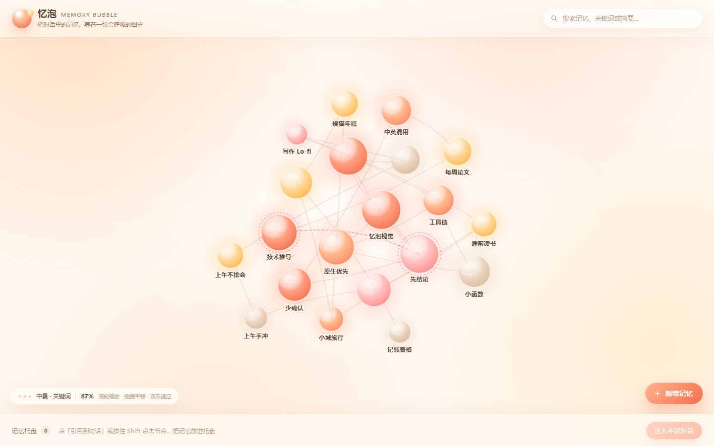

# 忆泡 Memory Bubble

> 把 AI 日常对话里沉淀的记忆，养成一张**会呼吸的泡泡图**——人看得见、管得住；AI 读得到、带得走。

**忆泡**是一个面向「日常和 AI 聊天的人」的记忆工具：每轮对话结束后，插件用你的默认模型自动总结出一条条记忆点，画成一张暖色泡泡图。泡泡大小 = 重要性（可手动改），离中心远近 = 出现频率；AI 每轮会收到一条稳定简报，所以它**记得住你**，而你不必把整段历史重复喂给它。

- 🫧 **看得见**：每个圆是一个记忆点，点开能改；连线是记忆之间的关系，冲突会亮红灯
- 🧠 **带得走**：一键导出 JSON / 记忆包，换聊天窗口、换模型、换设备都能继承；**其他 AI 也能直接下载使用（v0.2）**
- ✂️ **可控上下文**：稳定简报进上下文，托盘按需钉选，避免「聊到后面 AI 忘了前面」
- 🪟 **暖色、像在泡泡里**：奶油底、蜜桃气泡、三档语义缩放，深浅色跟随系统



> 图上每颗泡泡都是真实交互：拖动滑杆改重要性会实时变大，点连线能看关系与冲突，Shift+点泡泡放进「本轮记忆托盘」。

## 三个入口

### 1. 零门槛体验（离线原型，无需安装）

- **在线试玩（GitHub Pages）**：<https://eveneve-night.github.io/memory-bubble/>
- 或直接下载 [`prototype/index.html`](prototype/index.html)，双击用 Chrome / Edge 打开（单文件、零依赖、不联网）
- 玩法：滚轮三档缩放 → 点泡泡看详情/改重要性 → 点连线看关系 → 搜索 → 托盘注入 → 刷新后数据仍在（localStorage）

### 2. 在 DeepSeek Harness 里使用（插件）

**先下载**：[插件包 v0.3.1](https://github.com/Eveneve-night/memory-bubble/releases/download/v0.3.1/dsh-memory-bubble-v0.3.1.zip)（解压即得 `dsh-memory-bubble/` 目录）

#### 方式 A：本地安装（当前版本）

```bash
git clone https://github.com/Eveneve-night/memory-bubble.git
cd memory-bubble
```

在 DSH 的 profile 目录里把它加进依赖，并在 loader（`cordis.yml`）插入一行 `memory-bubble`：

```bash
# profile 目录（桌面版默认在 ~/.dsh/profiles/desktop）
pnpm add "file:<path-to-clone>/plugin"
```

```yaml
# cordis.yml 的 loader 列表里加入（或让 plugin_manager 安装 bundle）
- id: memory-bubble
  name: dsh-memory-bubble
```

刷新 Web GUI 后，**侧栏出现「忆泡」图标**即安装成功。忆泡默认关闭，点侧栏图标打开小窗口；窗口可拖动、可缩放，窗口内 × 关闭。首次安装是空图、不读对话，开启「读取对话并自动生成」后才按会话积攒记忆。

#### 方式 B：复制进 `node_modules`

把 `plugin/` 复制为 `<profile>/node_modules/dsh-memory-bubble`，再在 `cordis.yml` 里插入上面那行。

> npm 包发布后会补上 `plugin_manager install_bundle` 的一行安装方式（bundle 自带 `cordis.patch.yml`，不需要手改 loader）。

安装后的入口：**侧栏「忆泡」图标**（打开可拖动/缩放的小窗口）、**设置页「忆泡」分区**（读取对话并自动生成开关、每轮最多生成条数、记忆总量上限、去抖间隔、注入方式、导入导出）。

### 3. 其他 AI 也要用？走互操作层（v0.2）

忆泡的记忆不是 DSH 专属。同一份 `state.json` 有四条通道可以给别的 AI 用，详见 **[INTEROP.md](INTEROP.md)**：

**先下载**：[互操作包 v0.2.1](https://github.com/Eveneve-night/memory-bubble/releases/download/v0.2.1/memory-bubble-interop-v0.2.1.zip)（MCP 服务器 + CLI + schema + 使用说明，解压后直接 `node interop/cli.mjs --help`）

```bash
# 打包一份记忆包（图 + 简报 + 便携提示词 + 工具清单）
node interop/cli.mjs bundle --out bundle.json

# 或者起一个 MCP 服务器，交给 Claude Desktop / Cursor
node interop/mcp-server.mjs --data "<profile>/.memory-bubble/state.json"
```

- **MCP**：5 个工具（search / brief / remember / link / forget）、3 个资源、1 个提示词，`initialize` 自带跨 AI 使用说明
- **CLI**：`list / search / brief / export / import / bundle / remember / forget`，零依赖
- **HTTP**（DSH 运行中）：`/memory-bubble/api/ai/bundle`、`/ai/prompt`、`/interop`
- **记忆包** `memory-bubble-bundle v1`：贴进别的 AI 的 system prompt 即可「继承」你的记忆

## 它在 AI 那边怎么工作

```
你的每一轮对话
   ├─ session/event 折叠（只认真实用户消息，跳过运行时上下文/技能注入）
   ├─ turn/end 去抖（默认 15s，同会话≥90s）→ 调默认模型抽取 JSON
   ├─ 合并入图：近似判重、追加时效、更新频率（整批可撤销）
   ├─ 稳定简报：固定顺序、动态尾注，同样的记忆产出同样的前缀（保 KV 缓存）
   └─ 下一轮注入：systemPrompt.section（primary）或 agent/pre-step（fallback）
```

AI 也能主动调用 5 个工具：`memory_brief`（读简报）、`memory_search`（检索）、`memory_remember`（记一条）、`memory_link`（连线）、`memory_forget`（遗忘/降权）。

## 数据与隐私

- 全部保存在本机 `<profile>/.memory-bubble/state.json`（临时文件 + `.bak` 原子写；导出在 `exports/`）
- 不联网、不遥测；「总结」走你已配置的默认模型（`llm.stream`）
- 抽取只发送最近窗口（默认 6000 字符），不发送整段历史
- 导出格式见 [`schema/memory-bubble-v1.schema.json`](schema/memory-bubble-v1.schema.json)，记忆包见 [`schema/memory-bubble-bundle-v1.schema.json`](schema/memory-bubble-bundle-v1.schema.json)；其他 AI/宿主可按此读写记忆
- 跨 AI 读取默认只读（MCP `--read-only`），写入需显式操作

## 目录

```
docs/      设计与可行性文档（DESIGN §12 是实现状态、§13 是互操作层；FEASIBILITY 为设计轮报告）
plugin/    DSH 插件：lib/{core,store,index,client}.js + dev/ 三套自测 + README
interop/   跨 AI 互操作：mcp-server.mjs / cli.mjs / lib.mjs + 自测（INTEROP.md 是使用说明）
prototype/ 离线可点原型（单文件）
schema/    对外 import/export 与记忆包 JSON Schema
assets/    README 截图
```

## 现状与路线

- ✅ v0.1：宿主半 + 客户端半完成，本地自检 core 12/12、host 13/13、client 3/3
- ✅ v0.2：跨 AI 互操作层（MCP / CLI / HTTP / 记忆包），自检 interop 5/5；导出格式对齐 JSON Schema
- ✅ v0.2.1：自动生成可控——读取对话总开关、每轮最多生成条数、记忆总量上限；「＋ 手动记一条」仅手动编辑
- ✅ v0.2.2：按会话归属（新装从零开始）、默认不读对话、防开局幻觉、一键清空本会话；已真机安装验证
- ✅ v0.3.0：浮窗化——侧栏图标打开可拖动/缩放的小窗口、窗口内关闭、默认关闭；移除 main 面板与输入框药丸，避免接管界面
- ✅ v0.3.1：修复工具注册 schema（5 个工具改为顶层 `type: 'object'` + `properties` + `required` 的标准 JSON Schema，修掉模型侧 `parameters` 校验报错）；自检 core 13/13、plugin 14/14
- ⏳ 下一步：把 v0.3.1 真机懒加载验证清单和截图补进 README；记忆自动归档与「遗忘曲线」

已知取舍：记忆抽取是**摘要式**的，不做向量检索（图 + 简报足够小，先把「看得见」做对）；冲突检测是启发式，需要人确认。

## License

[MIT](LICENSE) · 欢迎 issue / PR：<https://github.com/Eveneve-night/memory-bubble/issues>
